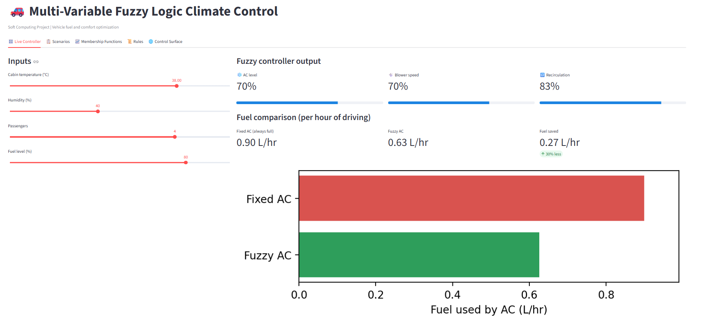
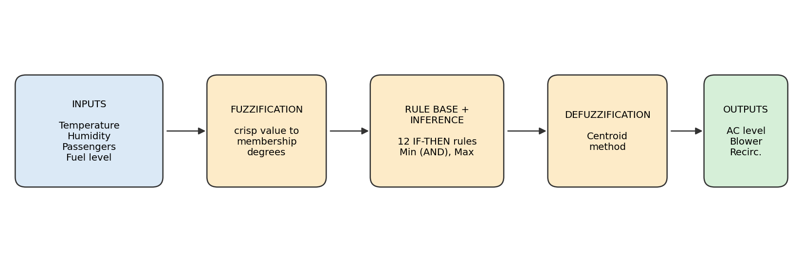
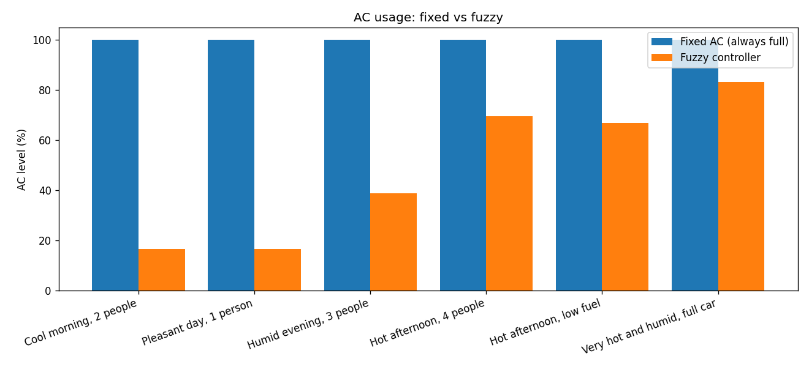
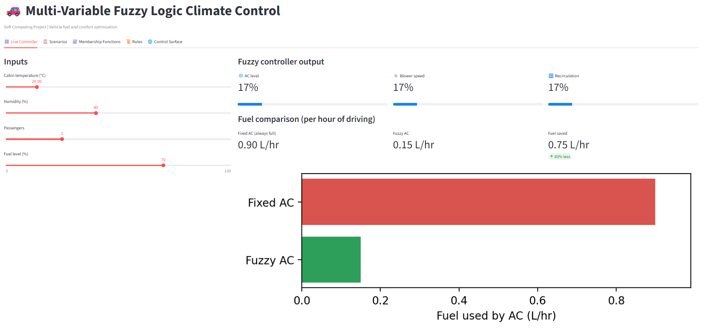
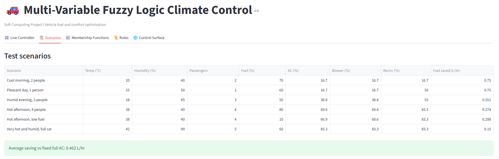
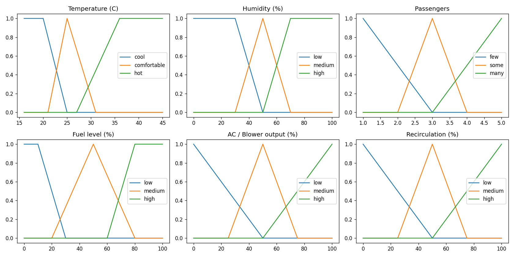
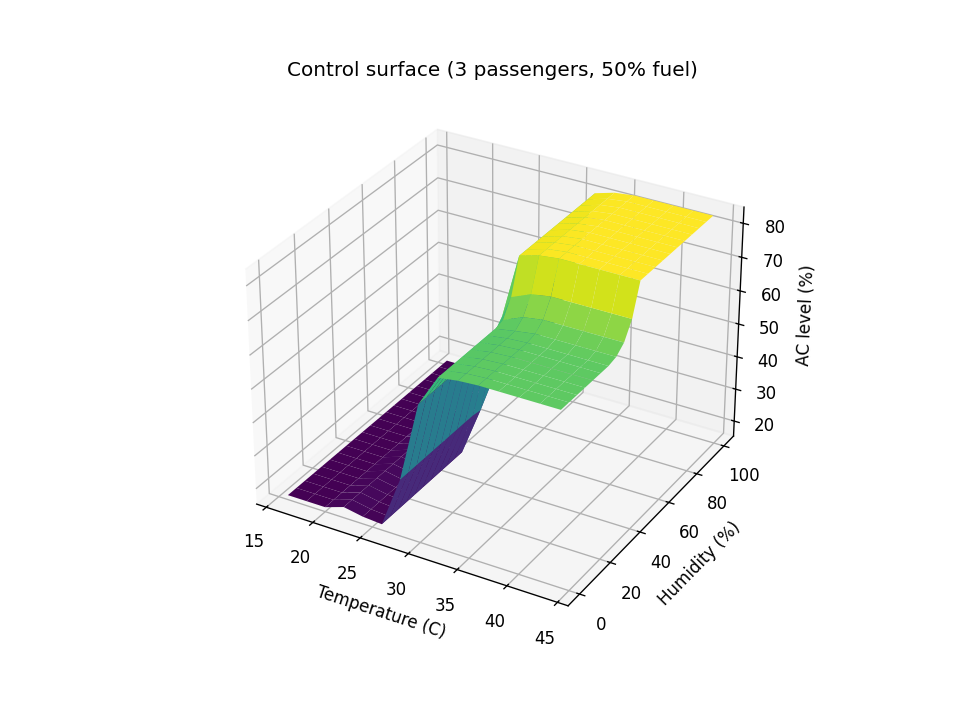

<div align="center">

# 🚗 Fuzzy Logic Climate Control

### Multi-Variable Fuzzy Logic Climate Control System for Vehicle Fuel and Comfort Optimization

*A Mamdani fuzzy controller that decides the AC level, blower speed and air recirculation of a car, so the cabin stays comfortable while the AC burns less fuel.*

[](https://fuzzy-climate-control.streamlit.app/)


<br>



### [▶ Try the live demo](https://fuzzy-climate-control.streamlit.app/)
*Drag the sliders and watch the AC, blower and recirculation react. The free host may take a few seconds to wake up.*

</div>

---

## 💡 The idea

A car's AC is driven by the engine. Running it at full power all the time wastes fuel, but switching it off makes the cabin uncomfortable. The trouble is that comfort is not a sharp number: people say *cool*, *a bit humid*, *hot* or *crowded*, and nobody agrees where one ends and the next begins.

Fuzzy logic is built for exactly this. This project reads four everyday conditions and turns them into three actions using 12 human-readable IF-THEN rules.

## ⚙️ How it works

<div align="center">

</div>

| | Variables |
|---|---|
| **Inputs (4)** | 🌡️ Cabin temperature (16-45 °C) · 💧 Humidity (0-100 %) · 👥 Passengers (1-5) · ⛽ Fuel level (0-100 %) |
| **Outputs (3)** | ❄️ AC level · 💨 Blower speed · 🔁 Recirculation (all 0-100 %) |
| **Method** | Mamdani inference, triangular and trapezoidal membership functions, centroid defuzzification |
| **Rules** | 12 rules, grouped by reason: temperature, humidity, passengers, fuel (eco mode) |

Fuel level works as an **eco priority**: when the tank is low, the controller limits the AC.

<details>
<summary><b>📜 See the 12 rules</b></summary>

<br>

| # | Group | Rule |
|---|---|---|
| 1 | Temperature | IF temperature is cool THEN AC low, blower low, recirculation low |
| 2 | Temperature | IF temperature is comfortable THEN AC low, blower low, recirculation medium |
| 3 | Temperature | IF temperature is hot THEN AC high, blower high, recirculation high |
| 4 | Humidity | IF comfortable AND humidity high THEN AC medium, blower medium |
| 5 | Humidity | IF hot AND humidity high THEN AC high, blower high |
| 6 | Humidity | IF hot AND humidity low THEN AC medium, blower medium |
| 7 | Passengers | IF comfortable AND passengers many THEN AC medium, blower medium |
| 8 | Passengers | IF hot AND passengers many THEN AC high, blower high |
| 9 | Passengers | IF hot AND passengers few THEN AC medium, blower medium |
| 10 | Fuel (eco) | IF fuel low AND hot THEN AC medium, recirculation high |
| 11 | Fuel (eco) | IF fuel low AND comfortable THEN AC low, blower low |
| 12 | Fuel (eco) | IF fuel high AND hot THEN AC high, blower high |

Writing a rule for every input combination would need 3⁴ = 81 rules. Grouping them by reason keeps the controller small enough to explain one rule at a time.

</details>

## 📊 Results

Compared with an AC that always runs at 100 %:

| Scenario | AC level | Fuel saved (L/hr) |
|---|---|---|
| Cool morning, 2 people | 16.7 % | 0.750 |
| Pleasant day, 1 person | 16.7 % | 0.750 |
| Humid evening, 3 people | 38.8 % | 0.551 |
| Hot afternoon, 4 people | 69.6 % | 0.274 |
| Hot afternoon, low fuel | 66.9 % | 0.298 |
| Very hot and humid, full car | 83.3 % | 0.150 |

**Average saving: 0.462 L/hr** under the assumed fuel model (see the limitations below).

What the numbers show:
- The AC level rises steadily as conditions get harder: about 17 % when it is cool, 70 % on a hot afternoon, 83 % when it is very hot, humid and the car is full.
- Humidity matters: a humid 28 °C evening needs more AC than a dry, pleasant 25 °C day.
- The eco rule works but is mild: low fuel trims the AC from 69.6 % to 66.9 % on the same hot afternoon.

<div align="center">

</div>

## 🖥️ The dashboard

Five tabs: **Live Controller**, **Scenarios**, **Membership Functions**, **Rules** and a 3D **Control Surface**.

<table>
  <tr>
    <td width="50%"><br><sub><b>Hot afternoon:</b> AC 70 %, saves 0.27 L/hr</sub></td>
    <td width="50%"><br><sub><b>Cool morning:</b> AC 17 %, saves 0.75 L/hr</sub></td>
  </tr>
</table>

<div align="center">

<br><sub><b>Scenarios tab:</b> all six test cases and the average saving</sub>
</div>

<br>

<div align="center">

<br><sub><b>Membership functions</b> of the four inputs and the three outputs</sub>
<br><br>

<br><sub><b>Control surface:</b> AC level against temperature and humidity (3 passengers, 50 % fuel)</sub>
</div>

## 🚀 Run it yourself

Tested with Python 3.12.

```bash
git clone https://github.com/pattysaurus/fuzzy-climate-control.git
cd fuzzy-climate-control
pip install -r requirements.txt

python fuzzy_climate_control.py   # results table in the terminal + PNG plots
streamlit run app.py              # interactive dashboard
```

## ⚠️ Assumptions and limitations

Being upfront about what this project does and does not prove:

- **The fuel model is assumed, not measured.** It uses a 3 kW compressor at full level and 0.3 L of fuel per kWh. The litres saved are illustrative, not real-vehicle data.
- **The baseline is the worst case.** An AC that always runs at 100 % is easy to beat. There is no comparison yet against an on/off thermostat or a PID controller.
- **No cabin dynamics.** The controller maps inputs to outputs instantly; the temperature over time is not simulated.
- **Hand-designed.** Rules and membership functions were written by hand, not tuned from data.

## 🗺️ Roadmap

- [x] Mamdani controller with 12 explainable rules
- [x] Fuel-saving estimate against a fixed AC
- [x] Interactive Streamlit dashboard, deployed online
- [ ] On/off and PID baselines for a fair comparison
- [ ] Cabin thermal model to simulate temperature over time
- [ ] Tune membership functions with a Genetic Algorithm or PSO
- [ ] Add engine load or vehicle speed as an input

## 📁 Project structure

```
fuzzy-climate-control/
├── app.py                      # Streamlit dashboard
├── fuzzy_climate_control.py    # controller, test scenarios, plots
├── requirements.txt            # Python packages
├── images/                     # dashboard screenshots and block diagram
├── comparison.png              # generated plots
├── control_surface.png
└── membership_functions.png
```

## 🧰 Built with

Python · scikit-fuzzy · NumPy · pandas · Matplotlib · Streamlit

---

<div align="center">

Soft Computing & Applications project · Amity School of Engineering and Technology, B.Tech CSE (Data Science)

Built by **Pratham Gaur** ([@pattysaurus](https://github.com/pattysaurus))

</div>
